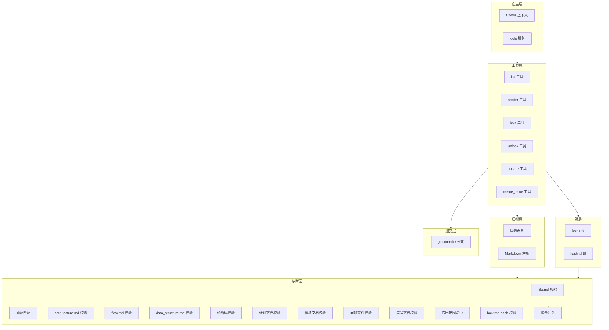
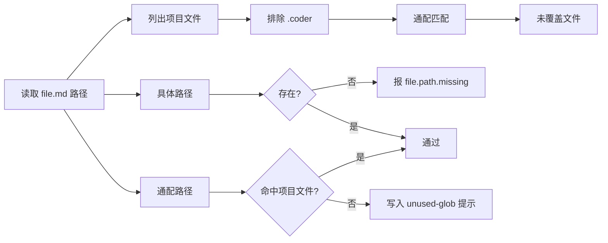
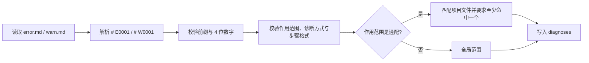
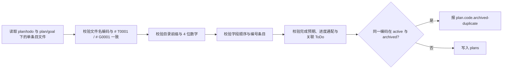
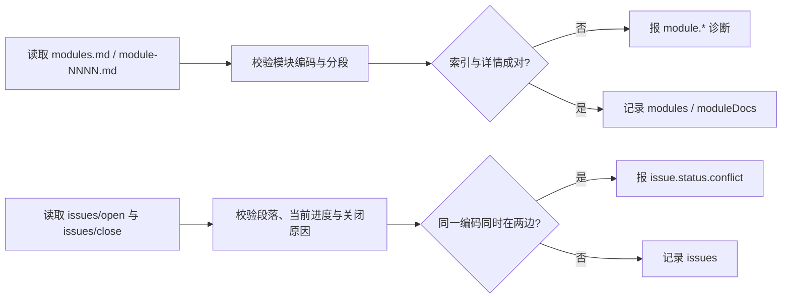
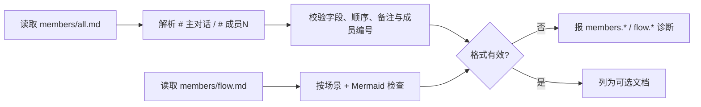
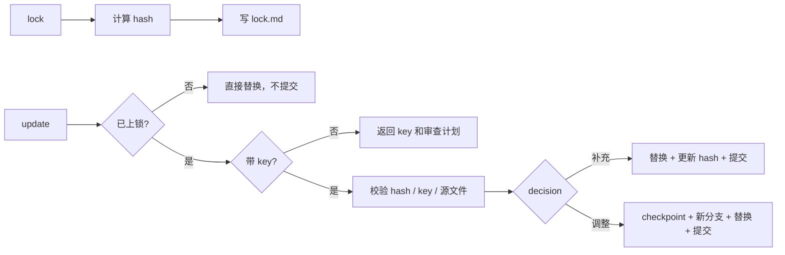
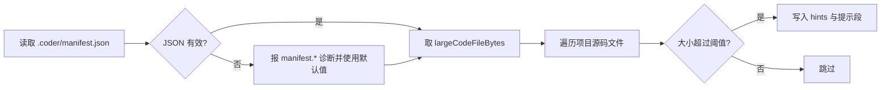
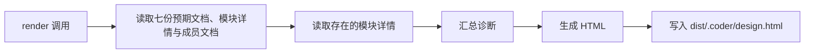

# 架构
## 全局视角
从 Host 的 tools 服务到六个工具，再向下经过扫描层和诊断层；file.md 的通配覆盖项目文件并反向检查标题引用，诊断码的文件通配范围在 list 时检查命中，计划条目、模块、问题文件与成员文档由 list 校验格式和交叉引用，大代码文件由 list 给出拆分提示，render 复用扫描结果生成 HTML。

## 局部视角：文档扫描
只回答「怎么发现文件、怎么比对预期文档」，不重复全局图的层。

## 局部视角：文件引用与覆盖
只回答「file.md 是否覆盖项目里的每个文件」以及「file.md 的标题是否指向真实路径」，`.coder` 自身除外。

## 局部视角：诊断码
只回答「error.md / warn.md 如何被解析和检查」：编码、作用范围、诊断方式、步骤格式和文件通配命中。

## 局部视角：计划条目
只回答「todo / goal 单条目文件如何被校验和归档」：文件名与标题编码、字段顺序、编号条目、完成预期、当前进度、关联 ToDo，以及 active 与 archived 是否重复。

## 局部视角：模块与问题
只回答「模块和问题文件如何被校验」：模块按索引与详情成对检查，问题文件按段落、进度或关闭原因与文件夹状态检查。

## 局部视角：成员文档
只回答「成员名册和成员流程如何被校验」：名册按主对话与成员分节检查字段，成员的可选备注写在最后，流程按场景和 Mermaid 图检查。

## 局部视角：数据结构
只回答「data_structure.md 如何被校验」：按 `##` 分段，每段读取 ts 围栏，提取 interface 名称并查重。

## 局部视角：锁定与更新
只回答「lock 如何约束修改、update 如何放行修改」；hash 计算复用全局图的锁层。

## 局部视角：大文件提示
只回答「list 如何提示大文件」：读取可选的 `.coder/manifest.json` 取阈值（默认 20KB），只统计源码扩展名并跳过依赖与产物目录；命中写入提示段，不改变 `ok`。

## 局部视角：渲染
只回答「render 如何把文档变成 HTML」，扫描和诊断复用全局图。

