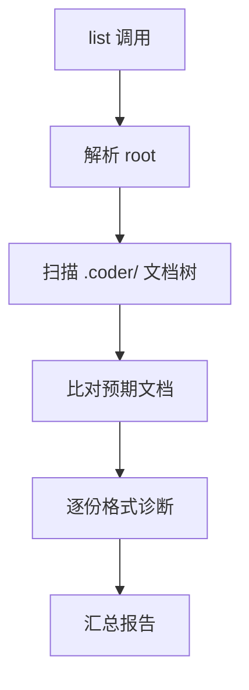
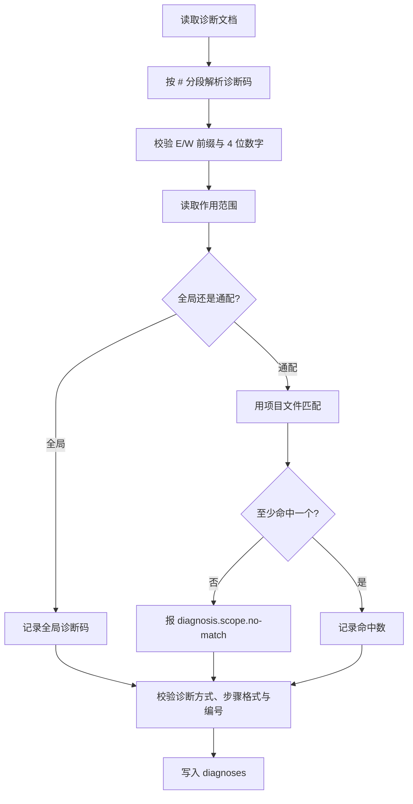
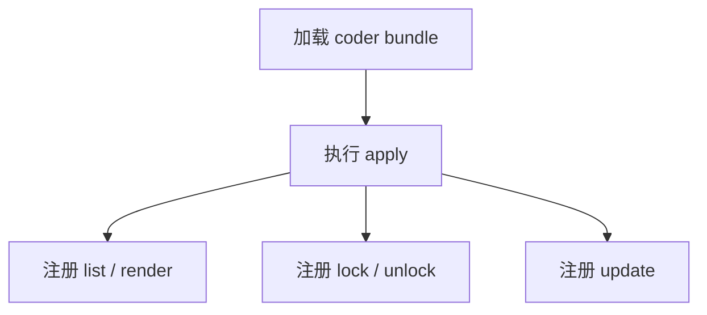
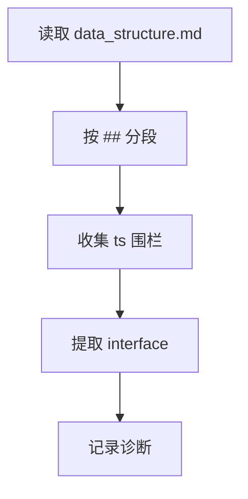
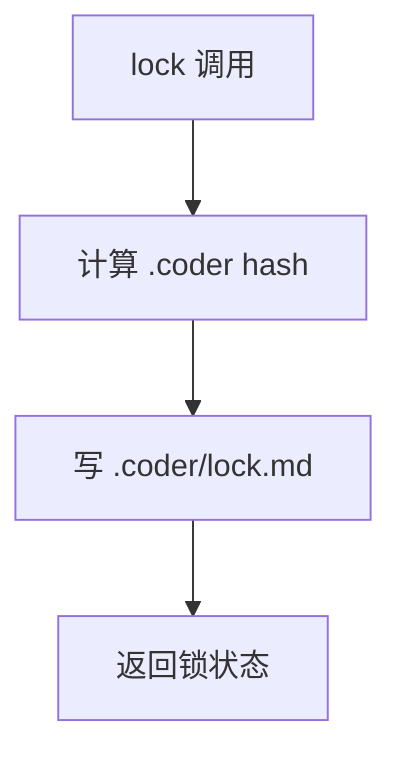
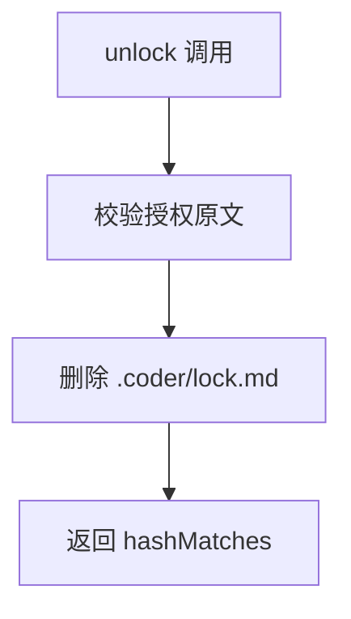
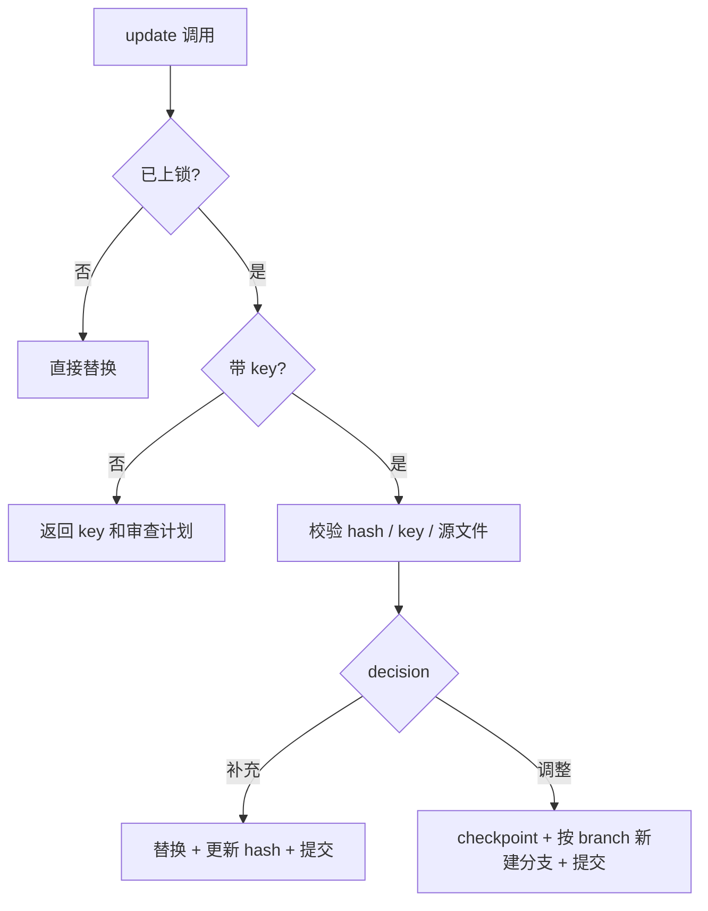
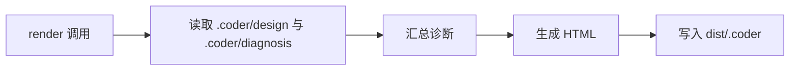

# 流程
## 检查项目文档

## 检查文件覆盖
用 file.md 的路径/通配检查项目里的每个文件。

## 检查诊断码
在 list 时解析 error.md 和 warn.md，校验编码、作用范围、诊断方式、步骤格式与编号；作用范围是文件通配时，以及步骤里的文件通配，都必须至少命中一个项目文件。

## 加载插件

## 检查数据结构
按 `##` 分段检查 data_structure.md 的 ts 围栏和 interface 声明。

## 上锁
lock 计算当前 .coder 的 hash，把声明、hash 和授权原文写进 lock.md。

## 解锁
unlock 校验授权原文，删除 lock.md；hash 不一致时仍然解锁并报告。

## 更新文档
update 从 tmp/ 读取源文件；上锁时先审查、再带 key 和 decision 执行。

## 渲染文档
把六份预期文档渲染成一个 HTML 页面。

