# 流程
## 检查项目文档
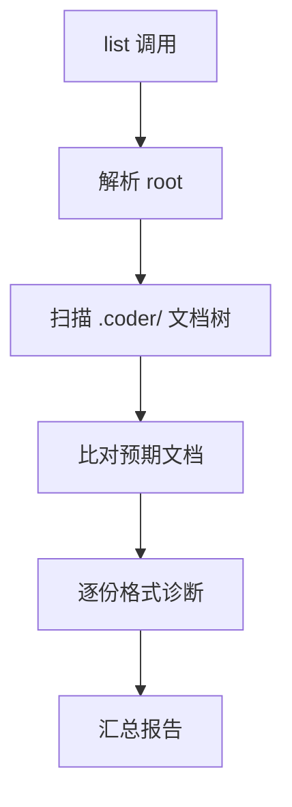
## 检查文件引用与覆盖
用 file.md 的路径/通配检查项目里的每个文件；同时反向检查 file.md 的标题：具体路径必须存在，通配零命中只给提示。

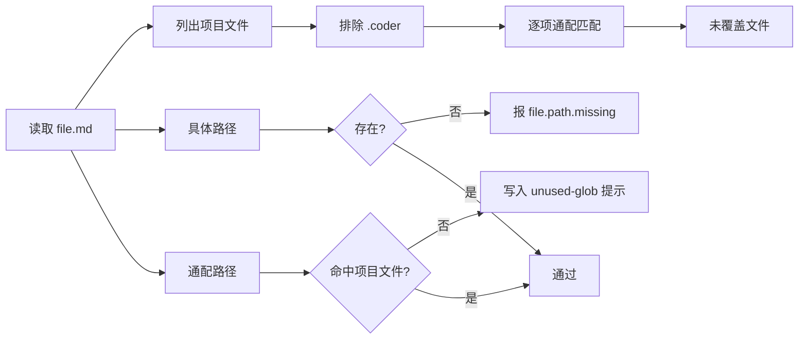
## 检查诊断码
在 list 时解析 error.md 和 warn.md，校验编码、作用范围、诊断方式、步骤格式与编号；作用范围是文件通配时，以及步骤里的文件通配，都必须至少命中一个项目文件。

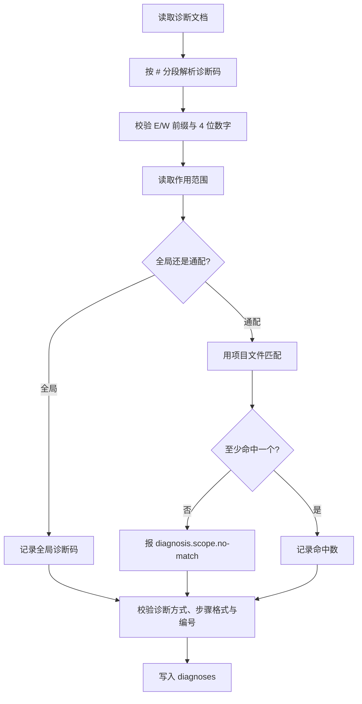
## 检查计划条目
在 list 时解析 plan/todo 与 plan/goal 下的单条目文件（含 archived），校验文件名编码与标题一致、目录前缀、字段顺序、编号条目、完成预期、当前进度和关联 ToDo；同一个编码不能同时留在 active 与 archived。

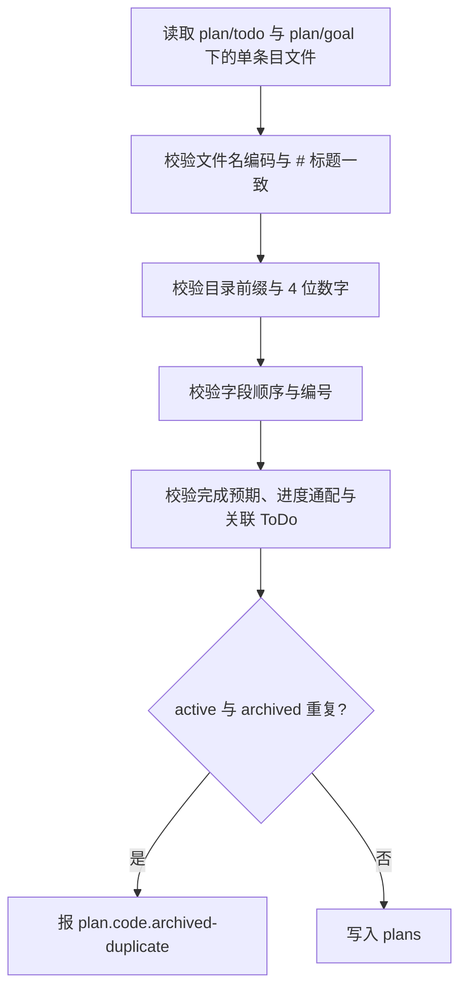

## 检查模块文档
list 解析 modules.md 和存在的 module-NNNN.md，校验模块编码、架构/流程/数据结构分段、子模块引用，以及索引与详情文件是否成对。

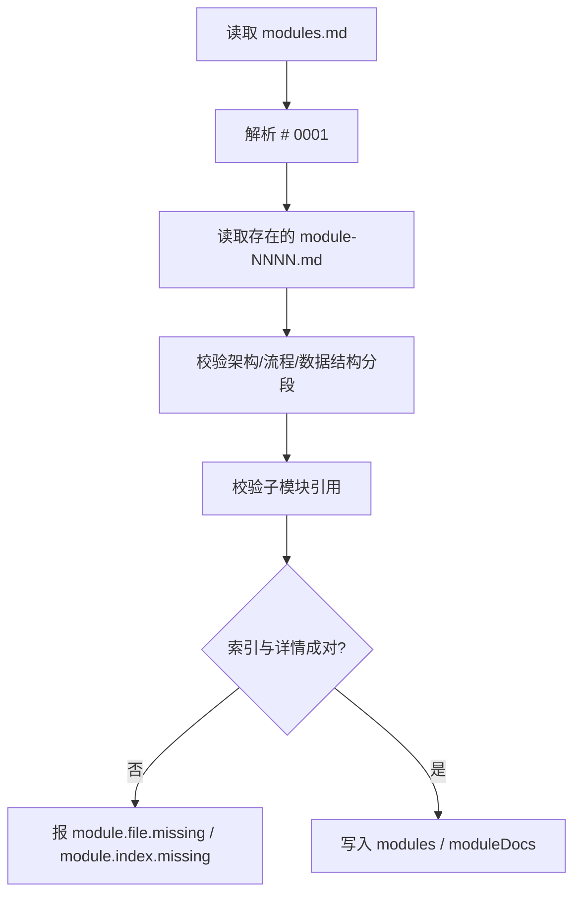

## 检查问题文件
问题文件都是可选的；存在时按所在文件夹校验状态、段落顺序、当前进度与关闭原因，并检查同一编码是否同时出现在 open/ 与 close/。

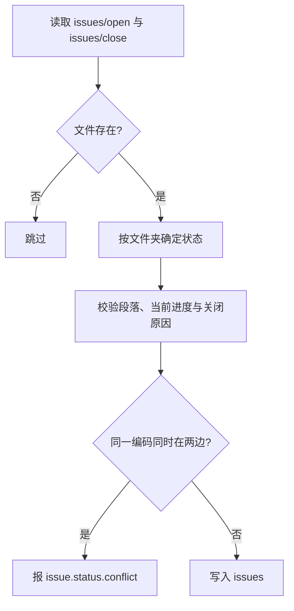

## 提示大文件拆分
list 读取可选的 .coder/manifest.json 取阈值（默认 20KB），只统计源码扩展名并跳过依赖与产物目录；超过阈值的文件写入提示段，不改变 ok。

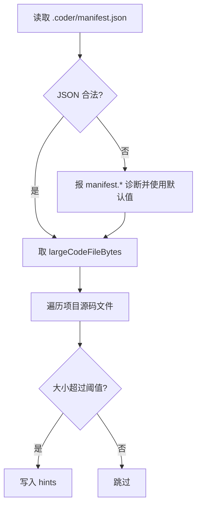

## 检查成员文档
成员文档都是可选的；存在时解析 members/all.md 的主对话与成员字段（成员的备注可选），members/flow.md 沿用场景和 Mermaid 规则。

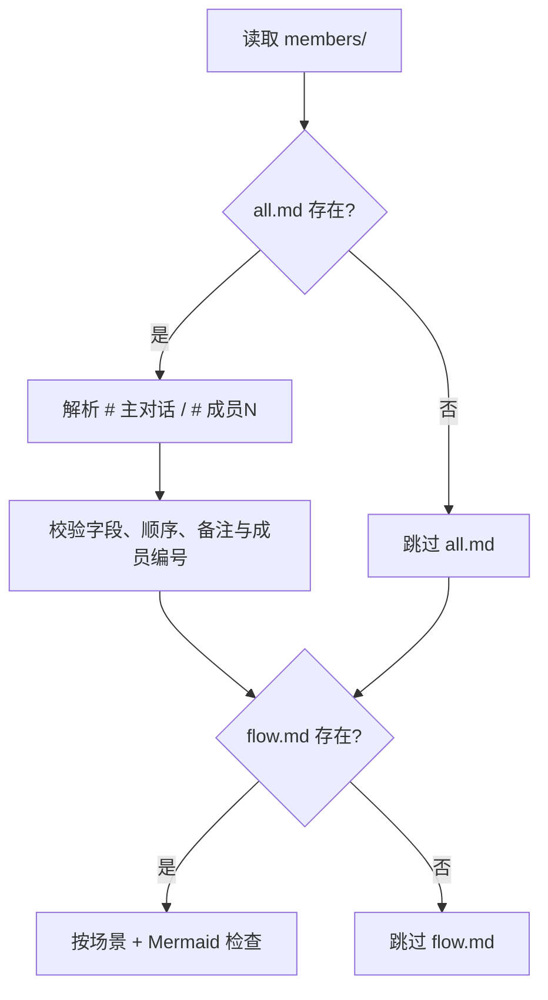

## 创建问题
create_issue 取两个问题文件夹里的最大编码加一，按状态写入 open/ 或 close/ 下的问题文件；上锁时拒绝写入。

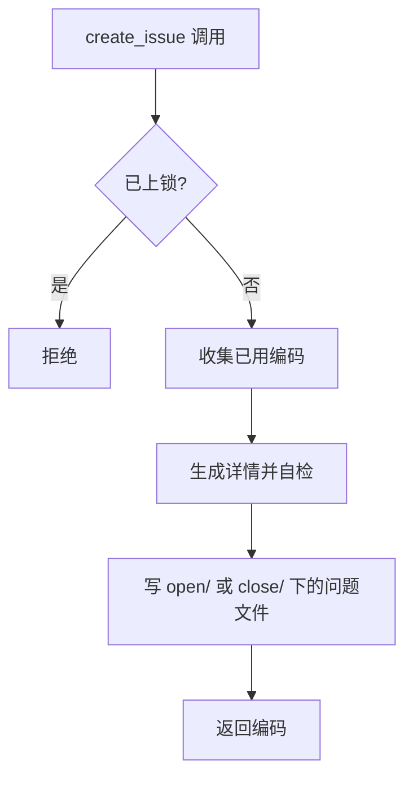

## 加载插件
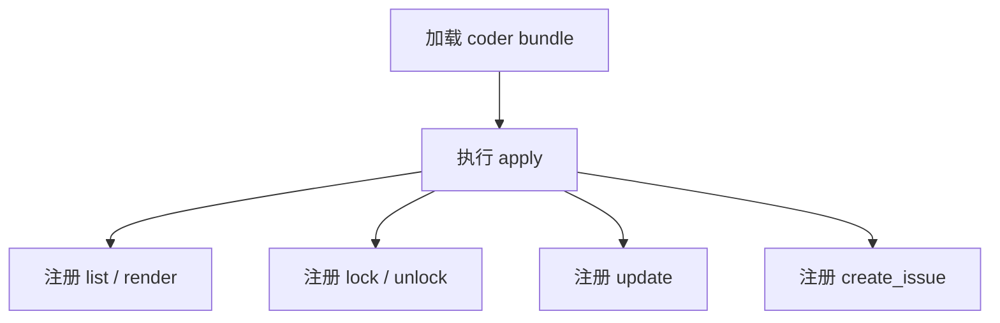
## 检查数据结构
按 `##` 分段检查 data_structure.md 的 ts 围栏和 interface 声明。

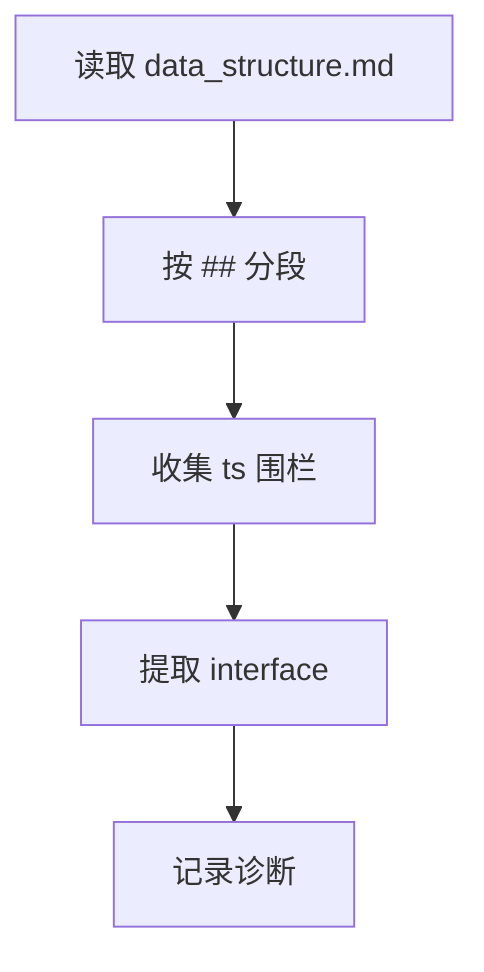
## 上锁
lock 计算当前 .coder 的 hash，把声明、hash 和授权原文写进 lock.md。

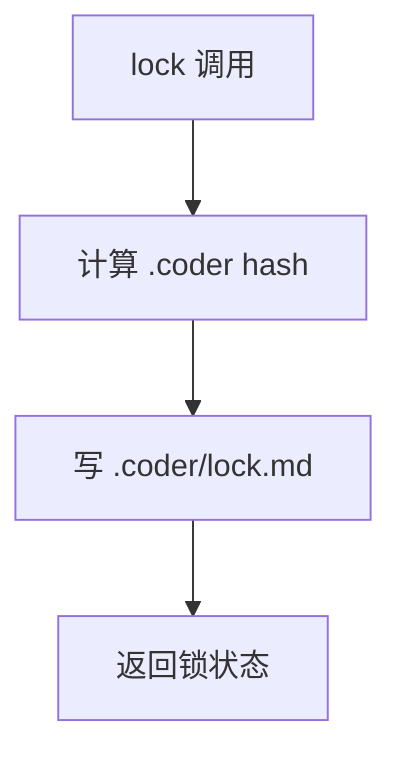
## 解锁
unlock 校验授权原文，删除 lock.md；hash 不一致时仍然解锁并报告。

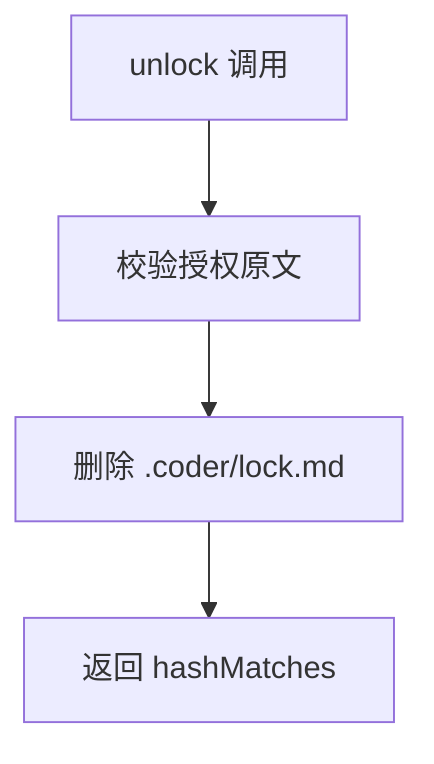
## 更新文档
update 从 tmp/ 读取源文件，目标可以是 .coder/ 下的任意文件；上锁时先审查、再带 key 和 decision 执行。

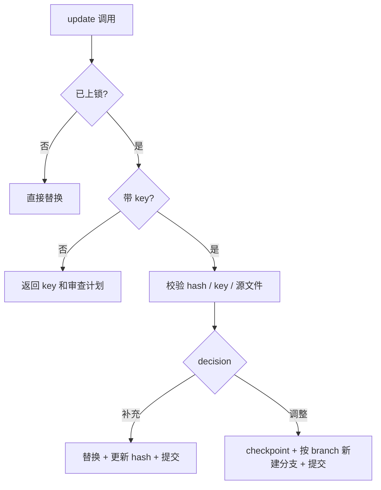
## 渲染文档
把七份预期文档、存在的计划条目、存在的模块详情和存在的成员文档渲染成一个 HTML 页面。

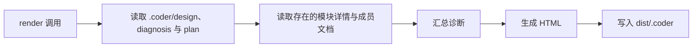
