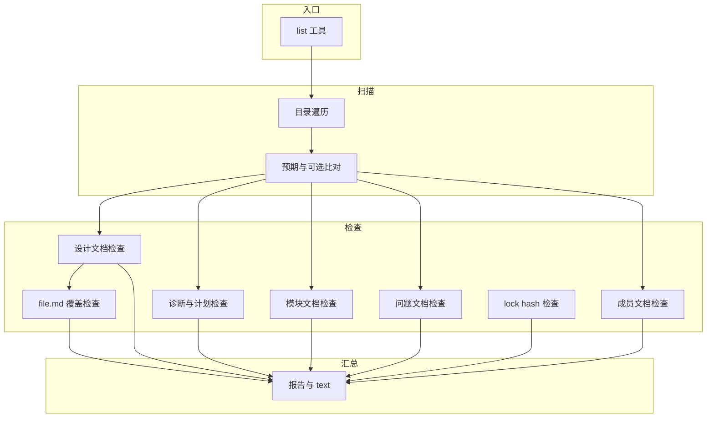
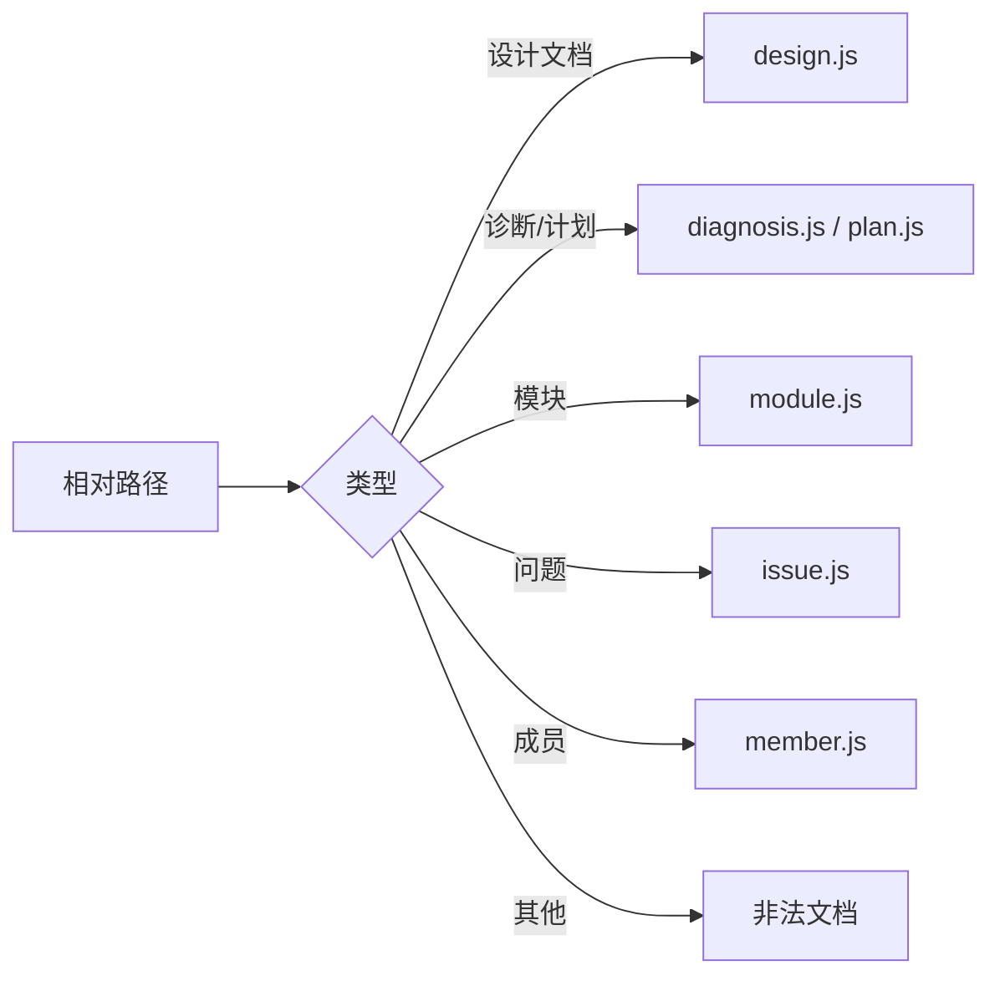
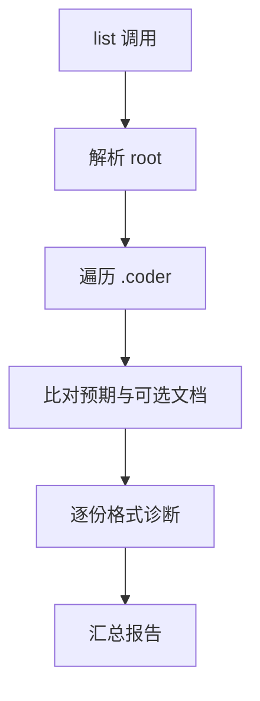

# 架构
## 全局视角
文档检查从项目根目录出发，扫描 `.coder` 下的全部文件，比对预期文档与可选白名单，再把每份 Markdown 交给对应的结构检查器。诊断与计划校验是检查层里的子模块。

## 局部视角：格式分派
每份文档按 `.coder/` 相对路径确定类型，再进入对应检查器；未知路径只作为非法文档报告。

# 流程
## 检查项目文档
list 读取根目录，遍历 `.coder`，逐份诊断后汇总报告。

## 汇总报告
报告同时给出结构化字段和可读 text；非法、缺失或诊断非空时 ok 为 false。

# 数据结构
## 检查报告
检查结果汇总了文档状态、诊断与各类条目数量。
```ts
export interface DocumentCheckSummary {
  expected: number
  found: number
  illegal: number
  optional: number
  missing: number
  diagnostics: number
  modules: number
  issues: number
}
```
## 诊断
每条诊断定位到文档和行，并带稳定规则代码。
```ts
export interface DocumentDiagnostic {
  doc: string
  line: number
  rule: string
  severity: 'error'
  message: string
}
```
# 子模块
## 0002
诊断与计划校验：诊断码、计划编码、模块索引和问题文件的确定性检查。
