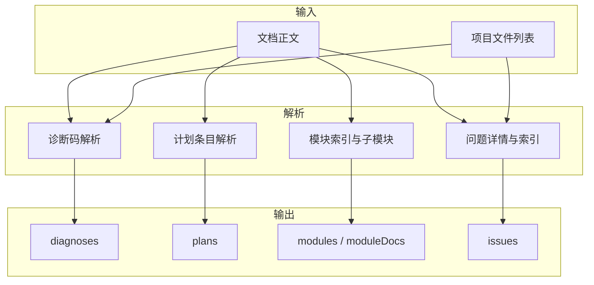
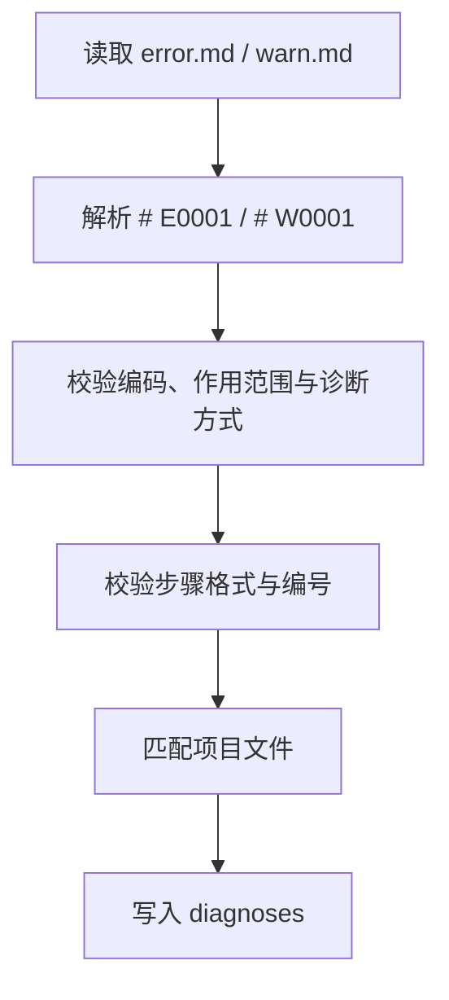
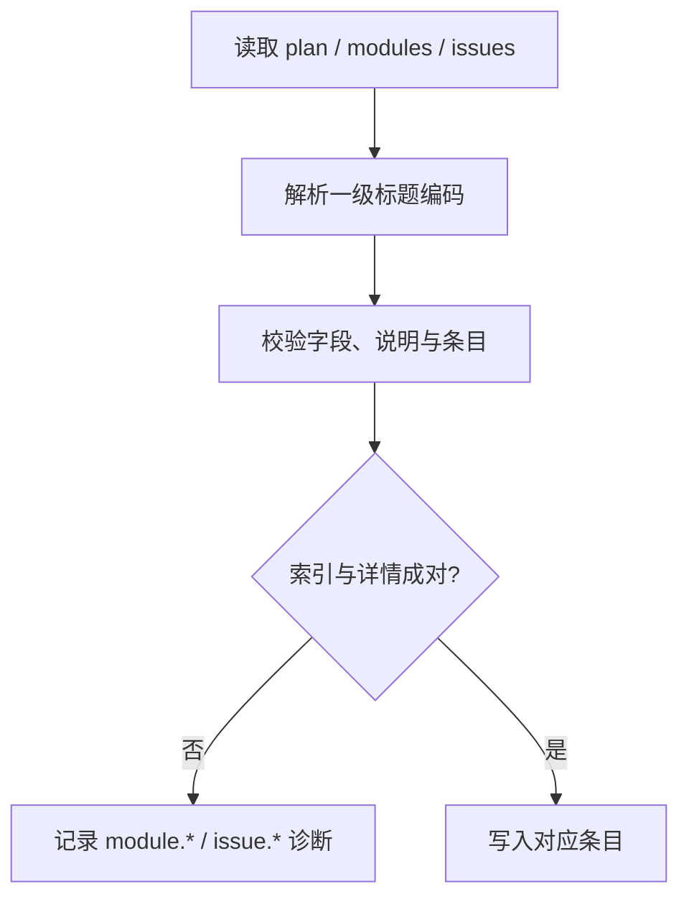

# 架构
## 全局视角
诊断与计划校验把文档文本解析成条目，再检查编码、字段、作用范围与交叉引用；它只依赖项目文件列表，不执行诊断步骤，也不判断任务是否真的完成。

# 流程
## 检查诊断码
诊断码按一级标题分段，校验前缀、作用范围、诊断方式和步骤；作用范围与步骤里的通配必须命中项目文件。

## 检查计划与模块问题
计划、模块索引和问题索引都按一级标题编码分段；交叉检查归档、索引与详情文件的对应关系。

# 数据结构
## 诊断码
诊断码条目记录作用范围、诊断方式和步骤命中数。
```ts
export interface IssueDiagnosisCode {
  code: string
  severity: 'error' | 'warn'
  scope: string | null
  method: string | null
  steps: number
  matches: number | null
}
```
## 问题条目
问题详情与索引共用 4 位编码，索引条目带进度或关闭原因。
```ts
export type IssueStatus = '开启' | '关闭'
export interface IssueEntry {
  doc: string
  line: number
  code: string
  status: IssueStatus | null
  scope?: string | null
  text?: string | null
}
```
