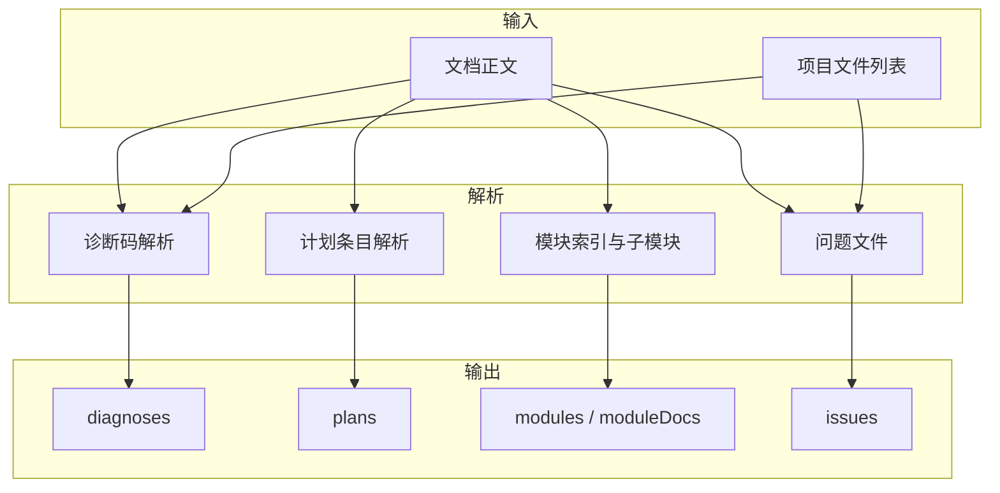
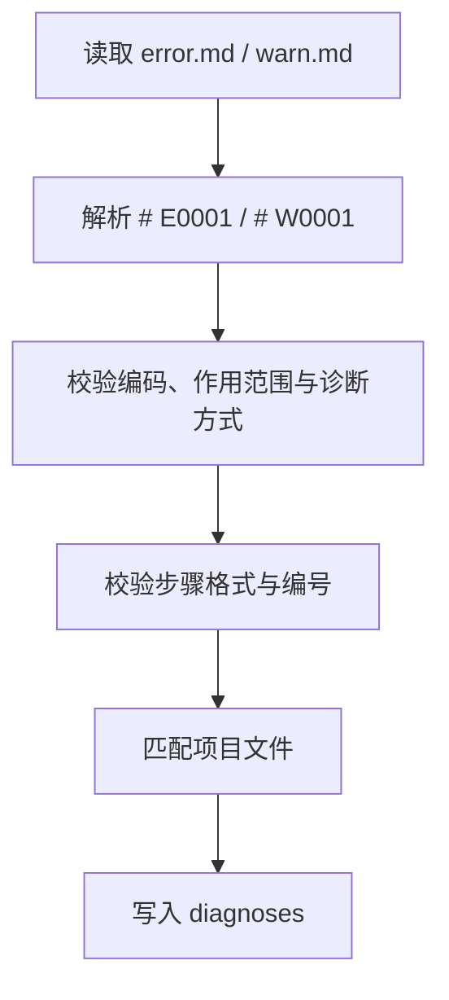
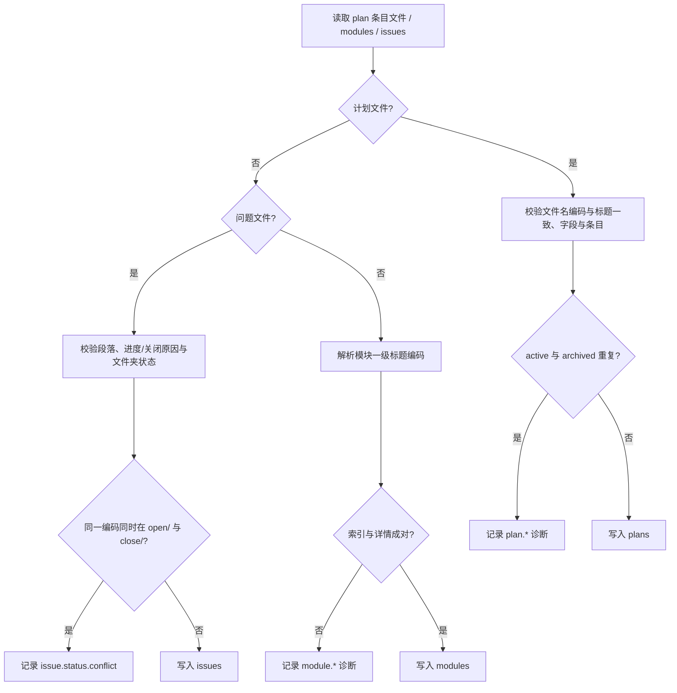

# 架构
## 全局视角
诊断与计划校验把文档文本解析成条目，再检查编码、字段、作用范围与交叉引用；它只依赖项目文件列表，不执行诊断步骤，也不判断任务是否真的完成。

# 流程
## 检查诊断码
诊断码按一级标题分段，校验前缀、作用范围、诊断方式和步骤；作用范围与步骤里的通配必须命中项目文件。

## 检查计划条目、模块与问题
计划条目按目录区分 active 与 archived、按文件名定位编码；模块索引按一级标题编码分段；问题文件按 open/ 与 close/ 文件夹区分状态；交叉检查归档与问题状态。

# 数据结构
## 诊断码
诊断码条目记录作用范围、诊断方式和步骤命中数。
```ts
export interface IssueDiagnosisCode {
  code: string
  severity: 'error' | 'warn'
  scope: string | null
  method: string | null
  steps: number
  matches: number | null
}
```
## 问题条目
问题文件按文件夹区分状态，文件名是 4 位编码；开启的问题带当前进度，关闭的问题带关闭原因。
```ts
export type IssueStatus = '开启' | '关闭'
export interface IssueProgress {
  line: number
  scope: string | null
  text: string
  matches: number | null
}
export interface IssueEntry {
  doc: string
  line: number
  code: string
  status: IssueStatus
  progress: IssueProgress | null
  reason: string | null
}
```
