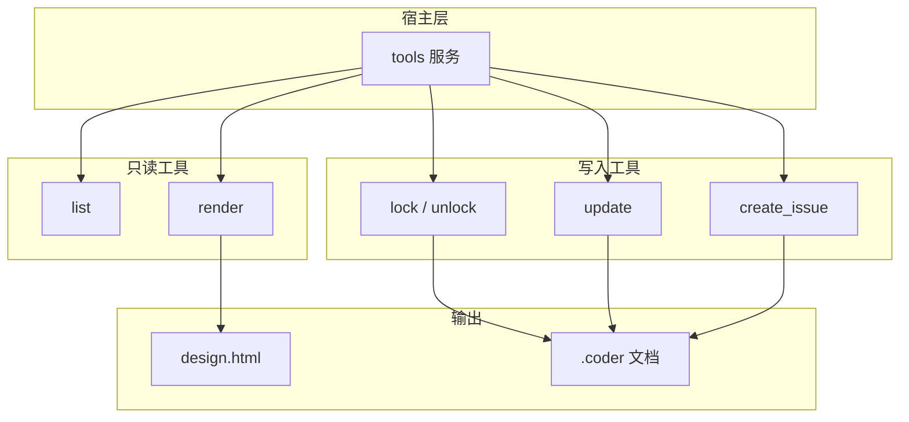
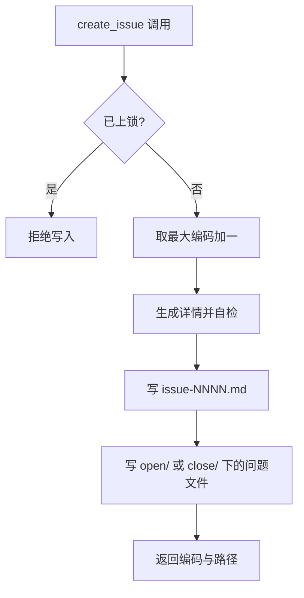
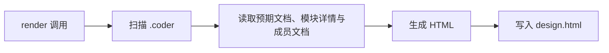

# 架构
## 全局视角
工具层把确定性的读写操作包成 DSH 工具：`list` / `render` 只读并返回结构化结果，`lock` / `unlock` / `update` / `create_issue` 写入 `.coder`。写入路径都先校验再落盘，上锁时拒绝绕过 update。

# 流程
## 创建问题
create_issue 先在内存里生成固定段落并自检，再按状态写 open/ 或 close/ 下的问题文件；上锁时直接拒绝。

## 渲染页面
render 复用 list 的扫描结果，读取预期文档、存在的模块详情与成员文档，生成单页 design.html。

# 数据结构
## 工具结果
工具返回结构化字段和可读 text；写入工具额外返回路径与编码。
```ts
export interface ToolResult {
  ok: boolean
  text: string
  output?: string
  code?: string
  issue?: string
  index?: string
}
```
## 渲染结果
渲染结果记录输出路径、字节数和当前文档健康状态。
```ts
export interface RenderOutcome {
  output: string
  bytes: number
  healthy: boolean
  missing: string[]
  illegal: string[]
}
```
