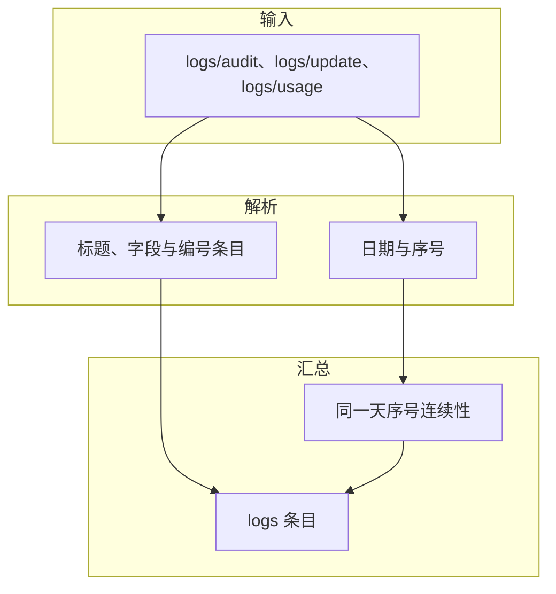
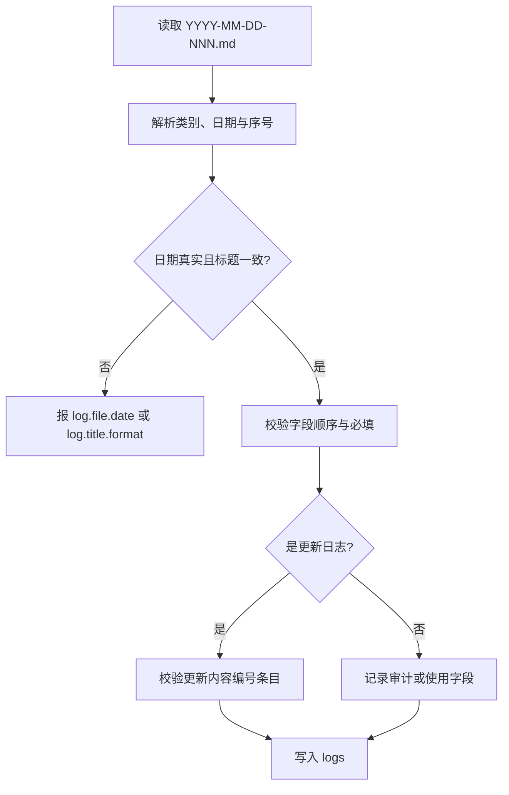

# 架构
## 全局视角
日志校验从 `logs/audit`、`logs/update` 与 `logs/usage` 读出条目文件，先按路径确定类别与日期序号，再校验内容，最后按类别与日期汇总并检查同一天序号是否连续。

# 流程
## 校验一个日志文件
按文件名取出类别、日期与序号，校验日期真实、标题一致、字段顺序与必填，再校验更新内容的编号条目。

# 数据结构
## 日志条目
日志条目记录类别、日期序号与各字段值，供 list 汇总展示。
```ts
export interface LogEntry {
  /** 展示用文档路径 */
  doc: string
  /** 所在目录决定的类别 */
  kind: 'audit' | 'update' | 'usage'
  /** 文件名里的日期 */
  date: string
  /** 文件名里的三位序号 */
  sequence: string
  /** 更新内容的编号条目数 */
  items: number
}
```
