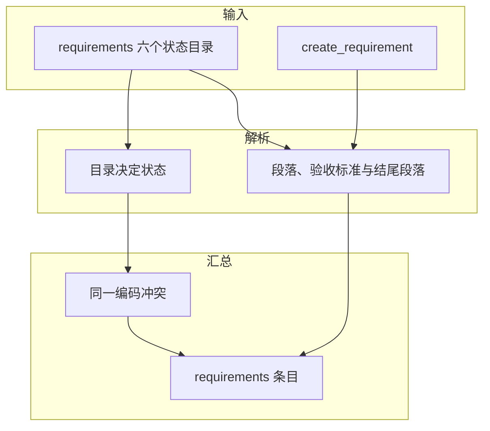
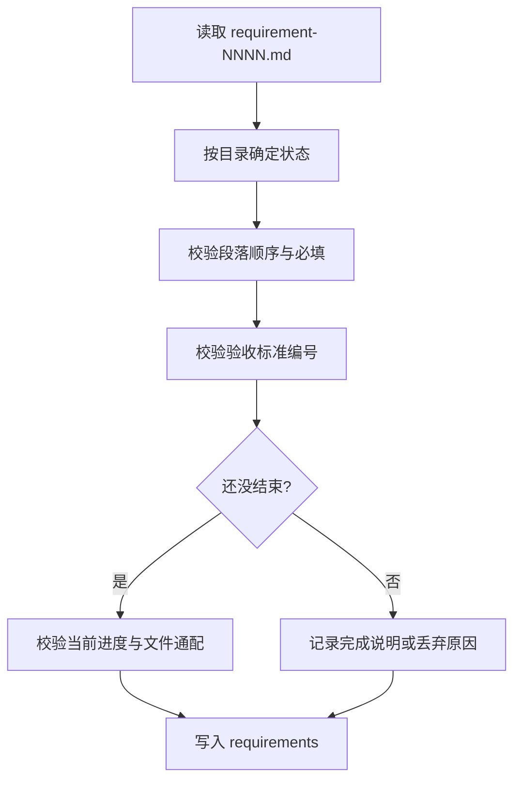

# 架构
## 全局视角
需求管理按目录确定状态，把文件解析成需求条目，再校验段落、验收标准与结尾段落；扫描层汇总六个状态并交叉检查同一编码是否出现在多个目录，create_requirement 复用同一套编号与格式规则写入新需求。

# 流程
## 校验一个需求文件
按目录取状态，校验段落顺序与必填、验收标准编号，再按状态校验当前进度或完成说明/丢弃原因。

# 数据结构
## 需求条目
需求条目记录状态、验收标准数量与结尾段落，供 list 汇总展示。
```ts
export interface RequirementEntry {
  /** 展示用文档路径 */
  doc: string
  /** 文件名里的 4 位编码 */
  code: string
  /** 所在目录决定的状态 */
  status: string
  /** 验收标准条目数 */
  criteria: number
  /** 完成说明或丢弃原因 */
  conclusion: string | null
}
```
