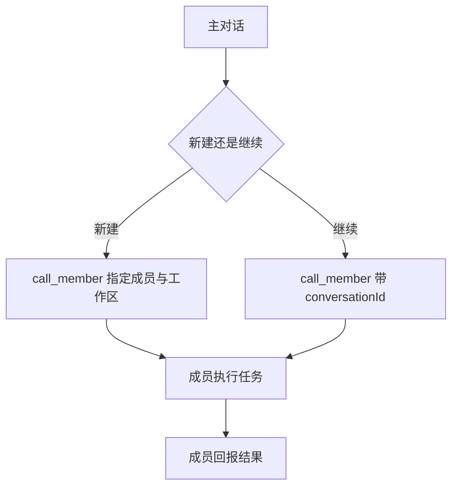
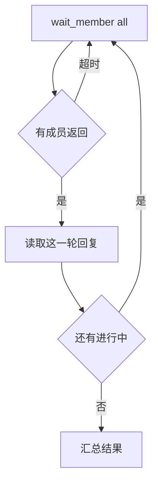
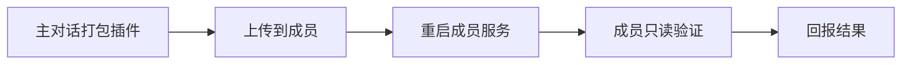
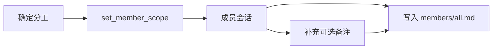

# 成员流程

## 分派任务
主对话用 call_member 在成员工作区新建对话，或带 conversationId 继续已有对话；成员执行任务并回报结果。

## 等待与汇总
主对话用 wait_member 的 all 模式等待任一成员返回；还有进行中的会话就继续等，全部结束后汇总。

## 部署与验证
主对话把插件同步到成员并重启成员服务；成员在临时目录运行 list 和工具检查，回报版本与验证结果。

## 身份与范围
主对话用 set_member_scope 设置成员的身份和工作范围，并把同一组值记录到 members/all.md；部署方式、SSH 用户等补充信息写成可选的备注。

